# YodaMan Architecture Overview

This document describes the architecture of YodaMan v0.6.5, a local-first workspace intelligence platform for developers.

> **Before deleting any file listed here:** a significant part of this system is
> wired up at runtime rather than through imports — plugins are `require()`d from
> a computed path, plugin UI components are named as strings in
> `plugins/plugin.json`, and several files are entry points launched by a host
> (Electron, VS Code, Expo, npm `bin`). Import-graph tools report all of it as
> unused. See the "Never delete code just because nothing imports it" section in the
> workspace `AGENT.md`, which is kept outside this repository.

## System Architecture

YodaMan is organised in six layers. Dependencies mostly point downward, but not
strictly: `ToolBox` (infrastructure) calls `SearchPipeline` (core), and
`GraphRanker` and `WorkspaceReadiness` call `SpecDrift` (Stardust).

```
Frontend (React + Vite)
    │  HTTP, SSE, WebSocket (/api/stardust/live)
    ▼
Interface Layer — RestController.js + routes/ (editor, git, graphify, stardust)
                  + support/ (git, http, workspaces)
    │
    ▼
Services Layer — fileUploadService, gitService, searchRouter
    │
    ▼
Core Layer — AgentReasoningEngine, ConversationBuffer, DefaultCodingSkill,
             QueueService, SearchPipeline, SearchSummary, StardustBrief,
             promptBudget
    │
    ▼
Infrastructure Layer — AuditLog, CliOutput, ContextEngine, DataPaths, Database,
                       DependencyChecker, DependencyDoctor, EditorLauncher,
                       FileSystemWatcher, GraphFacts, GraphRanker,
                       GraphifyDoctor, GraphifyService, ImpactAnalyzer, Logger,
                       McpClients, OllamaConfig, OriginPolicy, PairingService,
                       PluginAPI, SessionStore, SettingsProvider, SetupPlanner,
                       TaskStore, ToolBox, UninstallPlanner, WorkspaceReadiness
    │
    ▼
Stardust Layer — SpecBaseline, SpecDrift, StardustLive, StardustWrapper
    │
    ▼
External — Context Expert CLI (ctx, which runs models through Ollama),
           Graphify CLI, OpenSpec CLI, Ollama, simple-git, local file system
```

The diagram below shows which modules `require()` which, taken from the code.
`Logger`, `DataPaths` and `CliOutput` are used by many modules and are left out
to keep it readable.

```mermaid
graph TD
    subgraph Interface_Layer
        API[RestController]
        Routes[routes: editor, git, graphify, stardust]
    end

    subgraph Services_Layer
        FileUpload[fileUploadService]
        GitService[gitService]
        SearchRouter[searchRouter]
    end

    subgraph Core_Layer
        Agent[AgentReasoningEngine]
        ConvBuf[ConversationBuffer]
        DefaultSkill[DefaultCodingSkill]
        Queue[QueueService]
        Pipeline[SearchPipeline]
        Summary[SearchSummary]
        Brief[StardustBrief]
        Budget[promptBudget]
    end

    subgraph Infrastructure_Layer
        Tools[ToolBox]
        Engine[ContextEngine]
        Graphify[GraphifyService]
        GraphFacts[GraphFacts]
        GraphRanker[GraphRanker]
        Impact[ImpactAnalyzer]
        Readiness[WorkspaceReadiness]
        Watcher[FileSystemWatcher]
        Audit[AuditLog]
        Database[Database]
        TaskStore[TaskStore]
        Session[SessionStore]
        Settings[SettingsProvider]
        DepCheck[DependencyChecker]
        DepDoctor[DependencyDoctor]
        GraphifyDoc[GraphifyDoctor]
        Setup[SetupPlanner]
        PluginAPI[PluginAPI]
        Origin[OriginPolicy]
        Pairing[PairingService]
        Editor[EditorLauncher]
        Mcp[McpClients]
        Ollama[OllamaConfig]
    end

    subgraph Stardust_Layer
        Baseline[SpecBaseline]
        Drift[SpecDrift]
        Live[StardustLive]
        Wrapper[StardustWrapper]
    end

    API --> Agent
    API --> Audit
    API --> Engine
    API --> DepCheck
    API --> DepDoctor
    API --> Editor
    API --> Watcher
    API --> Graphify
    API --> Mcp
    API --> Ollama
    API --> Origin
    API --> Pairing
    API --> Queue
    API --> Pipeline
    API --> Session
    API --> Settings
    API --> Setup
    API --> Tools
    API --> Readiness
    API --> Routes
    API --> FileUpload
    API --> SearchRouter
    Routes --> GitService
    Routes --> Editor
    Routes --> Settings
    Routes --> Graphify
    Routes --> GraphFacts
    Routes --> Impact
    Routes --> Pipeline
    Routes --> Drift
    Routes --> Live
    Routes --> Wrapper
    SearchRouter --> Pipeline
    SearchRouter --> Summary
    Summary --> Engine
    Agent --> ConvBuf
    Agent --> DefaultSkill
    Agent --> Engine
    Agent --> DepCheck
    Agent --> Graphify
    Agent --> Impact
    Agent --> Queue
    Agent --> Pipeline
    Agent --> Drift
    Agent --> Brief
    Agent --> TaskStore
    Agent --> Tools
    Agent --> Budget
    Queue --> Engine
    Queue --> Graphify
    Pipeline --> GraphRanker
    Pipeline --> Drift
    Pipeline --> Tools
    Brief --> GraphFacts
    Brief --> Graphify
    Brief --> Impact
    Brief --> Drift
    Tools --> Audit
    Tools --> Engine
    Tools --> Graphify
    Tools --> Impact
    Tools --> PluginAPI
    Tools --> Pipeline
    Tools --> Settings
    Tools --> Baseline
    Tools --> Drift
    Tools --> Wrapper
    Engine --> DepCheck
    Graphify --> DepCheck
    GraphFacts --> Graphify
    GraphFacts --> Impact
    GraphRanker --> Graphify
    GraphRanker --> Impact
    GraphRanker --> Drift
    Impact --> Graphify
    Readiness --> Graphify
    Readiness --> Queue
    Readiness --> Drift
    Watcher --> Queue
    Audit --> Database
    TaskStore --> Database
    DepDoctor --> DepCheck
    GraphifyDoc --> Graphify
    Setup --> DepCheck
    Baseline --> Engine
    Baseline --> GraphFacts
    Baseline --> Impact
    Baseline --> Pipeline
    Baseline --> Drift
    Drift --> GraphFacts
    Live --> Graphify
    Wrapper --> DepCheck
```



## Directory Tree

```
core/
├── backend/
│   ├── core/
│   │   ├── AgentReasoningEngine.js     # Agent loop: ctx ask → tool call → approval gate → result
│   │   ├── ConversationBuffer.js       # The agent's transcript, bounded to a prompt budget
│   │   ├── DefaultCodingSkill.js       # Standing coding guidance appended to every system prompt
│   │   ├── QueueService.js             # FIFO queue of ctx index jobs, then a graph update
│   │   ├── SearchPipeline.js           # THE search: Context Expert -> Graphify -> OpenSpec
│   │   ├── SearchSummary.js            # Local-model summary of search results, from those results only
│   │   ├── StardustBrief.js            # What the workspace already knows, handed to the agent up front
│   │   └── promptBudget.js             # Prompt size from the context window Ollama serves
│   ├── infrastructure/
│   │   ├── AuditLog.js                 # Tool-call audit trail
│   │   ├── CliOutput.js                # Strips known noise lines from CLI output; summarises errors
│   │   ├── ContextEngine.js            # ctx CLI wrapper: spawn, ask, project-name resolution
│   │   ├── DataPaths.js                # Per-user data folder for config.json and yodaman.db
│   │   ├── Database.js                 # Opens yodaman.db with node:sqlite; creates tables
│   │   ├── DependencyChecker.js        # Cross-platform tool locator + health checker
│   │   ├── DependencyDoctor.js         # `yodaman doctor` dependency report
│   │   ├── EditorLauncher.js           # Opens a file at a line in the user's editor
│   │   ├── FileSystemWatcher.js        # Chokidar watcher that queues re-indexing
│   │   ├── GraphFacts.js               # Workspace-wide structural graph queries
│   │   ├── GraphRanker.js              # Blends semantic rank with graph structure and spec coverage
│   │   ├── GraphifyDoctor.js           # `yodaman doctor --graph` report
│   │   ├── GraphifyService.js          # Graphify CLI wrapper: build, status, query, freshness
│   │   ├── ImpactAnalyzer.js           # Blast-radius analysis for file changes
│   │   ├── Logger.js                   # Structured JSON logging to console and a rotated file
│   │   ├── McpClients.js               # Which MCP clients read this workspace, and when
│   │   ├── OllamaConfig.js             # Read and change the context window Ollama serves
│   │   ├── OriginPolicy.js             # Blocks cross-site browser requests to the local runtime
│   │   ├── PairingService.js           # Pairing tokens for non-local clients
│   │   ├── PluginAPI.js                # API contract for legacy (onLoad/onEnable) plugins
│   │   ├── SessionStore.js             # Chat message persistence
│   │   ├── SettingsProvider.js         # Settings from config.json with YODAMAN_* env overrides
│   │   ├── SetupPlanner.js             # Ordered install plan for missing dependencies
│   │   ├── TaskStore.js                # Agent task records
│   │   ├── ToolBox.js                  # Built-in tools + plugin loader + permission validation
│   │   ├── UninstallPlanner.js         # What removing YodaMan would delete, without deleting
│   │   └── WorkspaceReadiness.js       # One readiness verdict from graph and index state
│   ├── interfaces/
│   │   ├── RestController.js           # Mounts every HTTP route; agent task SSE stream
│   │   ├── routes/
│   │   │   ├── editorRoutes.js         # /api/editor: open a file in the user's editor
│   │   │   ├── gitRoutes.js            # /api/git
│   │   │   ├── graphifyRoutes.js       # /api/graphify: build, status, artifacts, queries
│   │   │   └── stardustRoutes.js       # /api/stardust: run, drift, compose, board, impact
│   │   └── support/
│   │       ├── git.js                  # Git subprocess helpers (runGit, readGitContext)
│   │       ├── http.js                 # Shared validation and JSON error helpers
│   │       └── workspaces.js           # Workspace resolution and validation for route modules
│   ├── services/
│   │   ├── fileUploadService.js        # Temp file uploads for Chat attachments
│   │   ├── gitService.js               # Git reads via simple-git (history, heatmap, timeline)
│   │   └── searchRouter.js             # /api/search endpoints over SearchPipeline
│   └── stardust/
│       ├── SpecBaseline.js             # Draft specs for a workspace with none (Draft Specs)
│       ├── SpecDrift.js                # Architecture drift detection (spec vs. graph)
│       ├── StardustLive.js             # Real-time WebSocket + chokidar change watcher
│       └── StardustWrapper.js          # OpenSpec CLI subprocess wrapper
├── frontend/
│   ├── FileUploader.jsx                # Chat's attach-files button and file list
│   ├── voiceAgentBridge.js             # Voice input for Chat, with optional "Hey Yoda" hotword
│   └── voiceCommands.js                # SpeechRecognition wrapper + transcript normalizer
├── src/
│   ├── App.jsx                         # Root layout + tab navigation
│   ├── main.jsx                        # Vite entry point (React root)
│   ├── api/
│   │   └── api.js                      # HTTP client for the backend endpoints
│   ├── components/                     # React views (see Component Descriptions below)
│   ├── holocron/                       # Holocron constellation: layout, scene, timeline, voice, WebXR
│   ├── hooks/
│   │   ├── useHealthCheck.js           # Reusable /api/health polling hook
│   │   ├── useStardustLive.js          # WebSocket + useSyncExternalStore for Stardust
│   │   └── useStardustPipeline.js      # Three-tool readiness state for Stardust, fetched once
│   └── index.css                       # Global styles + custom scrollbar
├── bin/                                # CLI entry points: yodaman, yodaman-mcp
├── plugins/                            # Dynamically loaded tool plugins
├── public/                             # Static assets, in-app manual, vendored libraries
├── graphify-out/                       # Generated knowledge graph artifacts
├── electron/                           # Electron main process + preload
├── extensions/                         # VS Code extension
├── apps/                               # React Native (Expo) mobile app
├── shared/                             # Code shared by runtime and clients: protocol, client, tool capabilities, path lists
├── tests/                              # Jest suites
├── scripts/                            # Build, release, smoke-test and protocol scripts
├── docs/                               # Architecture, API, guides
├── packaging/                          # Homebrew formula
├── website/                            # Marketing website and downloads
├── dist/                               # Vite production build output (not committed)
├── release/                            # electron-builder output (not committed)
├── server.js                           # Express server entry point
├── start.js                            # Dev startup script
├── package.json                        # Node.js dependencies
└── vite.config.mjs                     # Vite build configuration
```

The user's data is not in this tree: `config.json` and `yodaman.db` live in the
per-user data folder (`backend/infrastructure/DataPaths.js`), so upgrades keep them.

## Layer Responsibilities

### 1. Interface Layer (`backend/interfaces/`)

`RestController.js` mounts every HTTP route under `/api`. Its first gate is
`OriginPolicy.crossSiteGuard` (cross-site browser requests get 403). Then McpClients
records MCP readers, and non-local clients must present a pairing token
(`X-YodaMan-Token`) while `requirePairingToken` is on. Route groups:

- **Projects**: `GET/POST/PUT/DELETE /api/projects`, `POST /api/reindex`
- **Ask & search**: `POST /api/ask`; `GET /api/search`, `/api/search/code`, `/api/search/docs`, `/api/search/stream`
- **Agent tasks**: `POST /api/agent/task` (SSE stream), `POST /api/agent/approve`, `POST /api/agent/cancel`, `GET /api/agent/pending-approvals`, `GET/DELETE /api/agent/tasks`, `GET /api/agent/tasks/:taskId/events`
- **Plugins**: `GET/POST /api/plugins`, `DELETE /api/plugins/:name`, `GET /api/plugins/:name/status`, `POST /api/plugins/:name/enable|disable|open`
- **Git**: `GET /api/git/context|history|heatmap|timeline|branch|commit`, `POST /api/git/branch|commit|pull|push`
- **Graphify**: `GET /api/graphify/status|report|map|artifact|build/status`, `POST /api/graphify/build|query|explain|path|affected|tree`
- **Stardust**: `POST /api/stardust/run` (`action`: `propose`, `validate`, `archive`, `list`, `init`, `install`, `diagnose`); `GET /api/stardust/drift|context|diagnose|board|spec|compose`, `GET /api/stardust/deltas/:name`, `GET /api/stardust/change-impact/:name`, `PUT /api/stardust/validation/:name`; WebSocket `/api/stardust/live`
- **Editor**: `GET /api/editor/options|preview`, `POST /api/editor/open`
- **Settings & policy**: `GET/PUT /api/settings`, `GET /api/policy`, `GET/POST /api/ctx/config`, `GET/POST /api/ollama/context`
- **Health & setup**: `GET /api/health|readiness|status|check`, `GET /api/setup/plan`, `POST /api/setup/repair`, `GET /api/desktop/diagnostics`, `GET /api/diagnostics/run`
- **Pairing**: `GET/POST /api/pairing`, `POST /api/pairing/revoke`
- **Chat sessions, audit & logs**: `GET/DELETE /api/sessions`, `GET/DELETE /api/audit`, `GET /api/logs`, `POST /api/logs/client-error`, `GET /api/mcp/clients`
- **File upload**: `POST /api/upload/temp`, `DELETE /api/upload/temp/:fileId`, `POST /api/upload/attach`, `GET /api/upload/task/:taskId/files`

Route modules under `backend/interfaces/routes/`:
- **editorRoutes.js** — `/api/editor` (open a file at a line, editor options and preview)
- **gitRoutes.js** — `/api/git`; reads go through gitService, writes run git directly
- **graphifyRoutes.js** — `/api/graphify`; every handler delegates to GraphifyService
- **stardustRoutes.js** — `/api/stardust`: the `run` action dispatcher, drift, compose, change impact, spec and board views

Support modules under `backend/interfaces/support/`:
- **http.js** — shared input validation and errors: `jsonError`, `validateString`, `validateProjectId`, `resolveUserPath`, `isLocalRequest`
- **git.js** — git subprocess helpers: `runGit`, `readGitContext`
- **workspaces.js** — workspace resolution and validation shared by the route modules

### 2. Services Layer (`backend/services/`)

| Module | File | Purpose |
|--------|------|---------|
| **fileUploadService** | `fileUploadService.js` | Temp uploads for Chat attachments, with Multer. Accepts `.dart`, `.js`, `.ts`, `.json`, `.yaml`, `.md`, `.log`, `.txt` up to 5 MB, deletes temp files after 1 hour, and links files to tasks. |
| **gitService** | `gitService.js` | Git reads via simple-git: commit history, blame, change frequency, heatmap data, the timeline for Holocron's history slider, commit diffs and branch info. |
| **searchRouter** | `searchRouter.js` | HTTP endpoints for search (`/api/search`, `/code`, `/docs`, `/stream`). Each calls `SearchPipeline.search` with a retrieval mode and shapes the response; it holds no search logic of its own. `/stream` then hands the same results to `SearchSummary`, which has the local model summarise them. |

### 3. Core Layer (`backend/core/`)

**AgentReasoningEngine**: The agent loop.
1. Builds a `StardustBrief` for the task: what the graph, the specs and drift say about the files involved
2. Loops for at most 10 steps: send the transcript to Context Expert (`ctx ask`) → parse up to 5 tool calls → run each → append the results
3. Any tool that changes something (`requiresApproval` in `shared/toolCapabilities.js`) pauses for the user: the UI shows the diff and the ImpactAnalyzer blast radius, and nothing is written unless it is approved
4. Streams events over SSE: `task_started` (sent by RestController), `tool_start`, `awaiting_approval`, `tool_end`, `final_answer`, `response_truncated`, `task_cancelled`, `error`

Two kinds of task skip the model. A plain search ("find where login is handled") runs the search pipeline directly, and "Run <plugin>" runs that plugin directly when it is read-only and the workspace is the only parameter it requires; a plugin that needs more, such as Lightsaber's `action`, goes through the loop so the model can choose it.

A "Draft baseline specs" task (the Stardust **Draft Specs** button) skips the tool loop: it calls SpecBaseline, then puts `openspec init` (if needed) and each drafted spec through the same approval gate.

**ConversationBuffer**: The agent's transcript, bounded. `ctx ask` is stateless, so the whole conversation is re-sent every step; the buffer keeps it within a budget so the prompt does not grow quadratically or exceed the operating system's argument-size limit. It lives in memory for one task.

**DefaultCodingSkill**: The standing coding guidance appended to every system prompt: surface assumptions, prefer the smallest change, keep edits surgical, verify with tests or builds, check drift and impact before risky edits.

**QueueService**: A FIFO queue of indexing jobs. Runs `ctx index` for each queued workspace, skipping paths already queued, under a unique index name (`ContextEngine.indexNameFor`) so two folders with the same name can both be indexed. After indexing it starts a Graphify update build.

**SearchPipeline**: The only place a search is assembled. Context Expert retrieves, duplicates and generated or missing files are dropped, Graphify ranks, OpenSpec tags, and the result reports which of the three contributed (`pillars`). See [Search Flow](#search-flow).

**SearchSummary**: The summary under a search. The local model (the one Context Expert is configured with) answers the query from the pipeline's results only, citing them; it never retrieves on its own.

**StardustBrief**: What the workspace already knows, handed to the agent before it starts: graph facts and blast radius for the files the task concerns, the specs that describe them, and drift.

**promptBudget**: How much prompt the agent may use, worked out from the context window Ollama is actually serving rather than a fixed size.

### 4. Infrastructure Layer (`backend/infrastructure/`)

| Module | File | Purpose |
|--------|------|---------|
| **ToolBox** | `ToolBox.js` | Built-in agent tools, plugin loader and permission validation. Loads `.js` files from `plugins/` and checks their permissions against `PLUGIN_PERMISSION_ALLOWLIST`. Commands run only from an executable allowlist, via `execFile` with no shell. Its `searchCode` tool is the search pipeline; raw retrieval (`contextExpertSearch`) is private to the pipeline. Records every tool call in AuditLog. |
| **ContextEngine** | `ContextEngine.js` | Spawns the `ctx` CLI (`ask`, `list`, and any command through `execute`/`executeJson`) and parses its JSON output; answers pass through CliOutput. Maps a workspace path to its ctx project name, and never to a different project that shares the folder name. Stops running ctx processes on shutdown. |
| **EditorLauncher** | `EditorLauncher.js` | Opens a file at a line in the user's editor: the OS default for the file type, a chosen app, or any command template (`{file}`, `{line}`, `{column}`). Never runs a shell. |
| **GraphifyService** | `GraphifyService.js` | Wraps the Graphify CLI: `build()`, `status()`, `freshness()`, `query()`, `explain()`, `pathBetween()`, `affected()`. Tracks whether the graph is older than the source. Finds the `graphify` launcher once, newest Python first, and finds it again if that launcher stops being able to start. |
| **Logger** | `Logger.js` | Structured JSON logs (`info`, `warn`, `error`) to the console and `~/.yodaman/logs/runtime.log`, rotated at 5 MB with 3 old files kept (`YODAMAN_LOG_DIR`, `YODAMAN_LOG_MAX_BYTES`, `YODAMAN_LOG_MAX_FILES`). A `requestId` middleware tags each request and logs it as `http_request`. |
| **AuditLog** | `AuditLog.js` | Records every tool call: tool, status, duration, sanitised parameters, and a result summary or the error. Stored in SQLite (`audit_logs`) when available, otherwise a JSON file; the in-memory list keeps the latest 500, returned newest first. |
| **SessionStore** | `SessionStore.js` | Chat messages per workspace, in a JSON file: read, append, clear. |
| **TaskStore** | `TaskStore.js` | Agent task records in SQLite or a JSON file: list, get, upsert, clear, prune. |
| **SettingsProvider** | `SettingsProvider.js` | Settings from `config.json` in the data folder, with defaults and `YODAMAN_*` environment overrides (`allowPluginUploads` → `YODAMAN_ALLOW_PLUGIN_UPLOADS`). `drift()` lists security settings changed from their defaults, which the server logs at startup. |
| **PairingService** | `PairingService.js` | Pairing tokens for non-local clients such as the mobile app, valid for 24 hours. Checked on every non-local request while `requirePairingToken` is on (the default). |
| **FileSystemWatcher** | `FileSystemWatcher.js` | Watches workspace folders with chokidar, ignoring generated, vendored and VCS paths, and queues a re-index in QueueService when files change. |
| **PluginAPI** | `PluginAPI.js` | The API handed to legacy plugins (Holocron VR style) that use `onLoad`/`onEnable` instead of `execute`: `fetch`, `log`, `ui`, `worker`, `config`. |
| **CliOutput** | `CliOutput.js` | Cleans CLI output shown to users: drops lines matching known tip and banner patterns (falling back to the raw text if nothing would be left), and summarises error output. |
| **DataPaths** | `DataPaths.js` | Where the user's data lives: `config.json` and `yodaman.db` in `~/Library/Application Support/YodaMan` (macOS), `%APPDATA%\YodaMan` (Windows) or `$XDG_CONFIG_HOME/YodaMan`, falling back to `~/.config/YodaMan` (Linux). `YODAMAN_DATA_DIR` moves it. Migrates data left next to the code by older versions. |
| **Database** | `Database.js` | Opens `yodaman.db` with Node's built-in SQLite (`node:sqlite`) and creates the `tasks` and `audit_logs` tables. Exports `db` and `useSqlite`; when SQLite is unavailable, TaskStore and AuditLog fall back to JSON files. |
| **DependencyChecker** | `DependencyChecker.js` | Finds Ollama, Context Expert, Graphify and OpenSpec on PATH and in each platform's usual install folders (Electron apps get a minimal PATH), runs each one to prove it starts and to read its version, checks Ollama is responding, and reports as missing a tool that cannot start (such as a launcher whose Python was removed, which it also skips when searching) or a ctx older than the minimum version. |
| **DependencyDoctor** | `DependencyDoctor.js` | Turns `DependencyChecker.checkAll()` into the `yodaman doctor` report. |
| **GraphFacts** | `GraphFacts.js` | Workspace-wide graph queries: orphan files, test coverage by file, the most central files, entry-point detection. |
| **GraphRanker** | `GraphRanker.js` | Blends Context Expert's semantic rank with Graphify structure (proximity, centrality) and OpenSpec spec coverage. Default weights: semantic 0.50, proximity 0.20, centrality 0.15, spec coverage 0.15. |
| **GraphifyDoctor** | `GraphifyDoctor.js` | The `yodaman doctor --graph` report: per workspace, whether a graph exists, its build state, node and edge counts, orphaned nodes and the most complex file. |
| **ImpactAnalyzer** | `ImpactAnalyzer.js` | Blast radius for one file, from the Graphify graph: what depends on it, up to a chosen depth (default 2 hops), and whether any test covers it. Runs at every agent approval prompt. |
| **McpClients** | `McpClients.js` | Records which MCP clients have read this workspace, and when, so the user can see who looked. |
| **OllamaConfig** | `OllamaConfig.js` | Reads and changes the context length Ollama serves, which defaults to a small window on many machines. |
| **SetupPlanner** | `SetupPlanner.js` | Turns a dependency check into an ordered install plan and runs it (`yodaman setup`, the Dashboard's Repair). |
| **UninstallPlanner** | `UninstallPlanner.js` | Lists what removing YodaMan would delete, without deleting anything (`yodaman uninstall`). |
| **WorkspaceReadiness** | `WorkspaceReadiness.js` | One verdict per workspace from its graph state (GraphifyService) and index state (QueueService): the weakest of `missing`, `unindexed`, `building`, `stale`, `ready`. For a single workspace it can add spec coverage from SpecDrift. |
| **OriginPolicy** | `OriginPolicy.js` | Rejects cross-site browser requests: an `Origin` that is not `localhost`, `127.0.0.1` or `[::1]`, or `Sec-Fetch-Site: cross-site`, gets 403 before any route runs. Also supplies the CORS origin rule. Requests without an `Origin` (CLI, mobile) pass on to the pairing-token check. |

### 5. Stardust Layer (`backend/stardust/`)

The Stardust layer connects YodaMan to OpenSpec, an external spec-driven change management CLI. It provides four capabilities:

| Module | File | Purpose |
|--------|------|---------|
| **StardustLive** | `StardustLive.js` | Real-time dashboard backend. Watches the `openspec/` directory with chokidar, builds change-board snapshots (task progress, validation status, graph freshness), parses operation-grouped spec deltas, and pushes live updates over WebSocket at `/api/stardust/live`. REST fallbacks: `GET /api/stardust/board`, `GET /api/stardust/deltas/:name`, `PUT /api/stardust/validation/:name`. |
| **StardustWrapper** | `StardustWrapper.js` | Runs the OpenSpec CLI as a child process for `diagnose`, `validate`, `archive`, `list`, `init` and `install`, preferring a global `openspec` and falling back to `npx openspec`. Propose does not call the CLI: `proposeChange` in `stardustRoutes.js` (and `ToolBox.specPropose`) writes the template files itself. |
| **SpecDrift** | `SpecDrift.js` | Compares intended architecture (file references in OpenSpec specs) with actual architecture (the Graphify graph). Reports `staleReferences` (a spec cites a file the graph has never seen) and `undocumented` (files with at least two dependents that no spec cites). |
| **SpecBaseline** | `SpecBaseline.js` | Drafts first OpenSpec specs for a workspace that has none: one capability per top-level module from the graph (six by default, at most twelve), its key code from the search pipeline, and the text from the local model through Context Expert. Writes nothing itself; callers put each draft through the approval gate. |

## MCP Server (`bin/yodaman-mcp.mjs`)

A second entry point that exposes the runtime's read paths to any MCP client
over stdio.

```
Cursor / Claude Code / Zed
  → stdio (newline-delimited JSON-RPC)
    → bin/yodaman-mcp.mjs
      → HTTP to 127.0.0.1:3090
        → the same routes the web UI uses
```

Five read-only tools: `yodaman_projects`, `yodaman_search`, `yodaman_graph_query`,
`yodaman_impact`, `yodaman_spec_drift`.

Two structural decisions:

- **It proxies rather than re-implements.** Ranking blends four signals behind an
  Express route. A second implementation inside the MCP process would drift from
  the first — the same failure mode as one ignore list becoming four.
- **Read-only is a boundary, not a default.** The approval gate lives in the
  agent loop, inside the runtime. A client on the far side of stdio never enters
  that loop, so no tool here can write. `tests/interfaces/McpServer.test.js`
  fails on a mutating tool name, on `PUT`/`PATCH`/`DELETE`, or on importing a
  write path.

It is ESM (`.mjs`) because the MCP SDK is ESM-only while the runtime is CommonJS.

## Plugin Architecture

```
plugins/*.js
    │  loaded by ToolBox.loadPlugins()
    ▼
ToolBox.validatePlugin(): an object with a string `name`, and `execute`
(or a legacy `onLoad`/`onEnable`); uploaded plugins must also declare `permissions`
    │
    ├── execute exists → register directly
    └── onLoad/onEnable exists → wrap with PluginAPI, register as execute
    │
    ▼
Available to the agent via getToolDefinitions() + callTool()
```

Plugins are loaded from the `plugins/` directory. Each `.js` file exports an object with:
- `name` (string, required) — unique identifier
- `execute(params)` (async function, required unless the plugin uses the legacy lifecycle) — the tool implementation
- `permissions` (string[]) — each from `PLUGIN_PERMISSION_ALLOWLIST`; required for plugins uploaded through the UI
- `description` (string) and `parameters` (JSON schema) — optional; shown to the agent and the UI

Legacy plugins using the `onLoad`/`onEnable` lifecycle are auto-wrapped with `PluginAPI`, which provides `fetch`, `log`, `ui`, `worker` and `config`.

## Key Data Flows

### Agent Task Execution

```
User → POST /api/agent/task { task: "Refactor App.jsx" }
  → RestController opens an SSE stream (task_started)
  → AgentReasoningEngine
    1. Builds a StardustBrief for the task (graph facts, specs, drift)
    2. Appends DefaultCodingSkill to the system prompt
    3. Sizes the prompt with promptBudget for the context window Ollama serves
    4. Reasoning loop (max 10 steps):
       a. Send the transcript (ConversationBuffer) to Context Expert (ctx ask)
       b. Parse up to 5 TOOL_CALL {...} lines
          (the older <tool_call> form is still accepted)
       c. Classify via shared/toolCapabilities.requiresApproval()
       d. If it changes anything: run ImpactAnalyzer for blast radius,
          compute the file as it WILL be, and pause for approval
          (SSE awaiting_approval). Read-only tools skip this.
       e. Execute the tool via ToolBox.callTool()
       f. Append the result to the transcript
    5. Stream final_answer via SSE
```

### Search Flow

Every search (Search view, Chat, the agent's `searchCode` tool, Trace, docs
search, Stardust Compose, the ask fallback, MCP) runs one pipeline,
`backend/core/SearchPipeline.js`. Callers choose what to retrieve; they cannot
skip a stage. `tests/architecture/SearchPipelineBoundary.test.js` fails the
build if code searches around it.

```
GET /api/search?query=authentication middleware
  → SearchPipeline.search({ mode: 'unified' | 'code' | 'doc' })
  → 1. Context Expert retrieves     ToolBox.contextExpertSearch (ctx search -p <index name>)
  → 2. Clean                        dedupe, drop generated files and files no longer on disk
  → 3. Graphify ranks               GraphRanker.rerank: semantic 0.50, proximity 0.20,
                                    centrality 0.15, spec coverage 0.15
  → 4. OpenSpec tags                each hit's covering specs (specFlag)
  → { results, pillars: { contextExpert, graphify, openspec }, dropped }
```

A workspace whose folder is missing is refused with `workspace_missing`. A
workspace Context Expert has not indexed falls back to a filesystem scan, and
`pillars.contextExpert` is false.

### Workspace Readiness Check

```
GET /api/health (all workspaces) or GET /api/readiness?projectId=<path> (one)
  → WorkspaceReadiness.forWorkspaces() / forWorkspace()
    → folder gone?  → "missing"
    → graph layer:  GraphifyService.freshness() → "ready" | "stale" | "building" | "unindexed"
    → index layer:  QueueService status         → "building" while this workspace is queued or being indexed, else "ready"
    → one workspace only: spec coverage from SpecDrift
  → Overall verdict = the weakest layer
  → Shown by Stardust (pipeline strip and Trust tab, via useStardustPipeline)
```

### Plugin Upload (zip)

```
User uploads plugin.zip
  → Multer saves to temp path
  → Extract with system unzip
  → Find main.js + plugin.json
  → Merge permissions from plugin.json into main.js
  → Copy main.js to plugins/
  → require() the plugin
  → ToolBox.validatePlugin() (permissions array required)
  → ToolBox.loadPlugins() (reloads all)
```

### Stardust Change Workflow

```
Stardust → Commands → POST /api/stardust/run { action, changeId, projectRoot }
  propose  → proposeChange(): writes openspec/changes/<changeId>/ with template
             proposal.md, design.md and tasks.md (no CLI call; existing files kept)
  validate → StardustWrapper.validate() → openspec validate <changeId>
  archive  → StardustWrapper.archive()  → openspec archive <changeId>
             (moves the change to the archive and merges its spec deltas
              into openspec/specs/)
  list | init | install | diagnose → the matching StardustWrapper call

Stardust → Commands → Draft Specs
  → sends "Draft baseline specs" to Chat
  → AgentReasoningEngine → SpecBaseline drafts one spec per module
  → openspec init (if needed) and each spec go through the approval gate
```

### Architecture Drift Detection

```
GET /api/stardust/drift (or the agent's specDrift tool) → SpecDrift.detectDrift(projectRoot)
  → Finds the OpenSpec root directory
  → Reads all spec files
  → Extracts file references from their text with a regular expression
  → Loads the graph through GraphFacts
  → Cited but not in the graph → staleReferences
  → At least 2 dependents but cited by no spec → undocumented (top 20 returned)
  → Returns counts and inSync (true only when specs exist and both lists are empty)
```

## Security Architecture

- **Cross-site requests**: `OriginPolicy.crossSiteGuard` runs before every route. A browser request whose `Origin` is not `localhost`, `127.0.0.1` or `[::1]`, or that says `Sec-Fetch-Site: cross-site`, gets 403. This stops a web page from driving the runtime over loopback.
- **Loopback binding**: the server listens on `127.0.0.1` by default (`YODAMAN_HOST`), and logs a warning when bound to anything else.
- **Pairing tokens**: non-local clients (the mobile app) need a pairing token in `X-YodaMan-Token`, valid for 24 hours, while `requirePairingToken` is on (the default).
- **File write approvals**: the agent pauses before any tool that changes something; the user approves or rejects in the UI, with the diff and the ImpactAnalyzer blast radius. A rejected write never reaches disk.
- **Command allowlist**: the agent may run only allowlisted executables, via `execFile` with no shell. Shell metacharacters are refused, and interpreter inline-eval flags (`node -e`, `python3 -c`) are rejected. `allowedCommands` adds executables.
- **Path validation**: file paths must resolve inside a watched workspace, after resolving symlinks.
- **Plugin permissions**: validated against `PLUGIN_PERMISSION_ALLOWLIST`; plugin uploads are off unless `allowPluginUploads` is enabled. Default plugins (`DEFAULT_PLUGINS`) cannot be removed or disabled.
- **Audit log**: every tool call is recorded with its parameters and duration (SQLite or JSON).
- **Settings drift**: security settings changed from their defaults are logged at startup (`security_setting_non_default`).

> **Design philosophy**: YodaMan is a local runtime serving one user. It has no user accounts, rate limiting or TLS. The threats it does defend against are a web page reaching it through the browser (OriginPolicy), other machines on the network (loopback binding, pairing tokens), and the agent itself (approvals, command allowlist, path checks).

## Frontend Architecture

### React Application (`src/`)

`src/` is laid out as shown in the [Directory Tree](#directory-tree): `App.jsx`
and `main.jsx`, the API client in `api/`, the views in `components/`, the
Holocron constellation in `holocron/`, and three hooks in `hooks/`.

The frontend talks to the backend over HTTP (`src/api/api.js`), with three
streaming channels: agent tasks use SSE, the Search view's summary streams over
`EventSource` (`/api/search/stream`), and Stardust's live board uses the
`/api/stardust/live` WebSocket. The `useHealthCheck` hook polls `/api/health`
every 5 seconds for `StatusBar`, `Dashboard` and `HealthDashboard`, and exposes
`{ checks, services, status, started, loading, error, refresh }`. The
`useStardustLive` hook uses React's `useSyncExternalStore` to subscribe to the
WebSocket, falling back to REST polling and reconnecting automatically. The
`useStardustPipeline` hook fetches the three tools' readiness once, so the
pipeline strip, the Trust tab and the Drift tab agree.

### Component Descriptions

| Component | File | Purpose |
|-----------|------|---------|
| **ActivityFeed** | `ActivityFeed.jsx` | Live file events from the watched `openspec/` directory (StardustLive WebSocket): a header slide-over drawer and an inline feed. |
| **AgentChatTab** | `AgentChatTab.jsx` | Chat and agent tasks over SSE: task submission, file attachments, voice input, approval prompts with the diff and blast radius, and chat history per workspace. |
| **AppErrorBoundary** | `AppErrorBoundary.jsx` | React error boundary. Catches render crashes and shows a reload screen with the error instead of a blank page. |
| **ChangeCard** | `ChangeCard.jsx` | One OpenSpec change on the Stardust board: name, validation icon, task progress bar and status label. |
| **ChangeImpactPanel** | `ChangeImpactPanel.jsx` | What carrying out a proposed change would disturb: every source file the change refers to, with its blast radius (two hops of reverse dependencies) and test coverage. |
| **ComposePanel** | `ComposePanel.jsx` | Stardust Compose tab: one file seen through all three tools: the specs that describe it (OpenSpec), its dependents, centrality, blast radius and tests (Graphify), and its semantic neighbours (Context Expert, ranked by Graphify). |
| **Dashboard** | `Dashboard.jsx` | System overview: health checks, ctx configuration, vector storage, AI engine and embedding settings, indexing, workspaces, environment, the user's data files, and a diagnostics report. |
| **EditorSettings** | `EditorSettings.jsx` | Settings → Editor: which program opens files from search results and Chat: the system default, an editor found on this machine, or a custom command with `{file}`, `{line}` and `{column}`. |
| **GitPanel** | `GitPanel.jsx` | Git history and branches: commit list, branch view, commit, pull and push. |
| **GraphStudio** | `GraphStudio.jsx` | Graphify knowledge graph: build status and the graph visualization. |
| **HealthDashboard** | `HealthDashboard.jsx` | Table of every dependency check from `/api/health`, via useHealthCheck. Has a compact mode for embedding. |
| **HealthIndicator** | `HealthIndicator.jsx` | Coloured dot for overall health: green all OK, yellow degraded, red error fetching, gray loading. |
| **HolocronVrModal** | `HolocronVrModal.jsx` | Holocron VR constellation modal, built on `src/holocron/` (Three.js scene, layout, history slider, voice, WebXR). |
| **ImpactAnalysisTab** | `ImpactAnalysisTab.jsx` | Stardust Impact tab: the blast radius of any file, 1 to 4 hops, with test coverage and the specs that reference it. |
| **LogsModal** | `LogsModal.jsx` | Structured log viewer with filtering by level, severity and user action. |
| **PipelineStrip** | `PipelineStrip.jsx` | The three mandatory tools drawn as a pipeline (Context Expert → Graphify → OpenSpec), with each one's readiness, on every Stardust tab. |
| **PluginAuthoringGuide** | `PluginAuthoringGuide.jsx` | In-app guide to building a plugin: the manifest, permissions, and the execute/onLoad patterns, with example plugin files. |
| **PluginsWindow** | `PluginsWindow.jsx` | Plugin list with upload, enable/disable and removal. |
| **ProjectList** | `ProjectList.jsx` | Workspace sidebar: add, select, sync and remove workspaces. |
| **SearchTrace** | `SearchTrace.jsx` | Why each search result ranked where it did: semantic score, proximity, centrality and spec coverage. |
| **SearchWindow** | `SearchWindow.jsx` | Search view: results from the search pipeline and the local model's summary of them. |
| **SettingsModal** | `SettingsModal.jsx` | Settings: workspace and developer options, the editor, and how to register YodaMan as an MCP server in each client. |
| **SpecDiff** | `SpecDiff.jsx` | A change's spec deltas grouped by operation (ADDED / MODIFIED / REMOVED / RENAMED), as the proposed text alone or side by side with the published spec. |
| **SpecDriftPanel** | `SpecDriftPanel.jsx` | Stardust Drift tab: stale spec references and undocumented load-bearing modules from SpecDrift. |
| **Stardust** | `Stardust.jsx` | The Stardust dashboard over Context Expert, Graphify and OpenSpec, with eight tabs: Board, Drift, Compose, Trust, Trace, Diagnostics, Commands and Impact. |
| **StardustKit** | `StardustKit.jsx` | Shared building blocks for every Stardust tab: `Panel`, `StatTile`, `StatRow`, `FileChip`, `SignalBar`, `Label`, `EmptyState`, `Spinner`, `ErrorNote`, `Explainer`, `GhostButton`. |
| **StatusBar** | `StatusBar.jsx` | Bottom status bar: health, runtime and connection state. |
| **TrustDashboard** | `TrustDashboard.jsx` | Stardust Trust tab: one verdict on whether YodaMan's answers about this workspace can be trusted right now (Ready, Stale, Working, Missing or Unknown), from WorkspaceReadiness and the drift report, plus runtime checks. |
| **WelcomeModal** | `WelcomeModal.jsx` | First-run welcome and onboarding. |

### Frontend Modules (`frontend/`)

The `frontend/` directory at the project root holds modules the React app
imports directly:

| Module | File | Purpose |
|--------|------|---------|
| **FileUploader** | `FileUploader.jsx` | Chat's attach-files button and file list. Accepts `.dart`, `.js`, `.ts`, `.json`, `.yaml`, `.md`, `.log`, `.txt`, shows each file's size, and lets the user remove it before sending. Used by AgentChatTab. |
| **voiceAgentBridge** | `voiceAgentBridge.js` | Voice input for Chat. Manages the SpeechRecognition lifecycle, an optional "Hey Yoda" hotword (off by default), a 10-second silence timeout, auto-submit after a 2-second pause, and its settings in `localStorage`. |
| **voiceCommands** | `voiceCommands.js` | SpeechRecognition constructor wrapper with the `webkitSpeechRecognition` fallback. Provides `createSpeechRecognition()` and `normalizeVoiceTranscript()`, which turns spoken punctuation into text (for example "new line" → a line break, "question mark" → `?`). |

## External Dependencies

| Dependency | Role | Required |
|------------|------|----------|
| **Context Expert** (`yodaman-ctx`, command `ctx`, 1.3.4 or later) | Code indexing, semantic search, and the agent's model calls | Yes |
| **Graphify** | Knowledge graph construction | Yes |
| **OpenSpec** (`openspec`) | Spec-driven change management (Stardust) | Yes |
| **Ollama** | Local model runner used by Context Expert | Yes |
| **simple-git** | Git reads | Yes (bundled) |
| **Node.js 24+** | Runtime | Yes |
| **Python 3.10+** | Graphify runtime | Yes |
| **Three.js** | Holocron 3D constellation rendering | Yes (bundled) |

