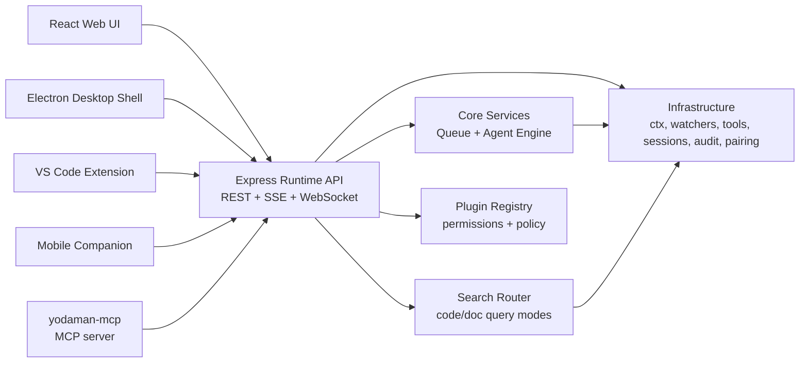
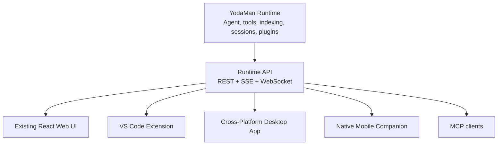

# YodaMan Agent Ecosystem Architecture

## Purpose

YodaMan is a local-first developer intelligence platform. The application provides a React user interface, an Express API, a ReAct-style agent runtime, Context Expert CLI integration, Graphify knowledge graphs, OpenSpec (Stardust), project indexing, file watching, tool execution, plugin tools, session persistence, and human approval for every agent action that changes something. Ollama is the only model runtime.

The runtime serves three integrated clients, all in this repository:

- A Visual Studio Code extension for editor-native agent work (`extensions/vscode-yodaman`).
- A mobile companion for approvals, monitoring, search, and lightweight commands (`apps/mobile`).
- A cross-platform Electron desktop application that is the control center for projects, plugins, indexing, sessions, and device pairing (`electron/`).

An MCP server (`bin/yodaman-mcp.mjs`, the `yodaman-mcp` binary) also offers read-only search, graph, and spec tools to other agents by proxying the runtime API.

The key architectural rule is that these clients should not duplicate agent logic. They should communicate with a shared YodaMan runtime through a stable API and event protocol.

## Current Runtime Shape

The current repository uses a clean layered architecture:

- Presentation: React and Vite.
- Interface: Express routes in `backend/interfaces/RestController.js`, with route modules in `backend/interfaces/routes/` and the search, upload, and git routers in `backend/services/`.
- Core: Agent orchestration, the search pipeline, and the indexing queue in `backend/core`.
- Infrastructure: Context Expert CLI wrapper, Graphify, file watching, session and task storage, audit, pairing, and tool execution in `backend/infrastructure`.
- Stardust: OpenSpec board, drift, and the live WebSocket feed in `backend/stardust`.

The runtime currently exposes:

- `GET /api/projects` for indexed and watched projects.
- `POST /api/projects` and `DELETE /api/projects` for project management.
- `POST /api/ask` for direct context questions.
- `POST /api/agent/task` for Server-Sent Events agent execution.
- `POST /api/agent/approve` and `POST /api/agent/cancel` for human approval of agent actions and task cancellation.
- `GET /api/search` for semantic search across code and docs (`/api/search/code` and `/api/search/docs` for one mode, `/api/search/stream` for the streamed Search view).
- `GET /api/health`, `GET /api/status`, and `GET /api/check` for health and diagnostics.
- `GET /api/plugins`, `POST /api/plugins`, and `DELETE /api/plugins/:name` for plugin management.
- `GET /api/agent/tasks`, `GET /api/agent/tasks/:taskId/events`, and `GET /api/agent/pending-approvals` for persisted task timelines.
- `GET /api/desktop/diagnostics` and `POST /api/pairing` for desktop and mobile companion flows.
- WebSocket `/api/stardust/live` for live OpenSpec board updates.

## Target System

## Runtime Responsibilities

The runtime should own:

- Agent execution and reasoning loops.
- Tool registry and plugin loading.
- Tool permissions, audit logs, and write approval state.
- Local audit and task history.
- Project indexing and file watching.
- Workspace identity and path validation.
- Session persistence.
- Model configuration (Ollama only).
- Event streaming for task progress.

## Client Responsibilities

Each client should own its own user experience:

- Rendering streamed task events.
- Capturing user prompts and commands.
- Asking the runtime to start, approve, reject, or cancel tasks.
- Showing diffs, logs, and status in a platform-native way.
- Managing notifications and device-specific affordances.

Clients should treat the runtime API as the source of truth.

## VS Code Extension

The VS Code extension makes YodaMan present inside the editor. It provides:

- An Activity Bar sidebar.
- Command palette commands for checking and starting the runtime, asking about the workspace, running and cancelling agent tasks, semantic search, adding and reindexing workspaces, blast radius for a file, the Stardust change board and spec drift, runtime diagnostics, pending approvals, and plugins.
- A `YodaMan` output channel.
- Native VS Code diff review for agent approvals.

So the first milestone is met: from VS Code, a user can ask YodaMan about the current workspace, run an agent task, watch tool events stream live, review a proposed file change in a native diff, and approve or reject it.

Not built yet: explaining files, refactoring selections, stopping the runtime, editor context actions (explain selection, generate tests, find related code, tasks from diagnostics), and inline code actions.

## Mobile Companion

The mobile client should avoid trying to become an IDE. Its strongest workflows are oversight and lightweight action:

- Monitor running agent tasks.
- Approve or reject proposed changes.
- Search indexed projects.
- Ask questions about a repository.
- Review completed task timelines.
- Notifications when a task needs approval or finishes are not built yet; the desktop app has them, the phone does not.

Mobile connection modes:

- Local network pairing for the first version.
- Optional secure relay later for remote access without exposing the local machine directly.

## Cross-Platform Desktop App

The React app is packaged as the desktop app with Electron (see [Desktop App](../clients/desktop-app.md)):

- The current React app is packaged with Electron.
- The Node backend runs as a managed sidecar.
- OS notifications, tray actions, and native folder picking are in place.
- Not built yet: in-app update support, and onboarding for the VS Code extension and mobile pairing.

Electron was chosen because the repository is already Node-based. Tauri can be reconsidered later if binary size and memory footprint become more important than development speed.

## Protocol Direction

The API is not versioned yet. Of the original near-term improvements, these are in place:

- Task lifecycle events defined in one schema (see [Runtime Event Protocol](../api/runtime-event-protocol.md)).
- An immediate task identity event (`task_started`) when a task starts.
- A task cancellation endpoint (`POST /api/agent/cancel`).
- A uniform error body with `error` and `code`.
- Workspace-scoped path validation for agent file tools.
- Patch-based file changes (`applyPatch`) alongside full-file writes.

Server-Sent Events carry task output because it primarily streams from the runtime to the client. The one WebSocket today is the Stardust live feed. WebSocket task subscriptions would be useful later for live multi-client task control, faster approval notifications, cancellation, presence, and collaborative state. They would not automatically make every workflow better: REST is still simpler for request/response actions, SSE is still good for one-way task timelines, and WebSocket adds connection, authentication, reconnection, and back-pressure complexity.

Shared protocol constants and TypeScript declarations live in `shared/` (generated from `shared/protocol.schema.json`), so clients can share event names and task shapes while the runtime remains CommonJS-compatible.

## Security Direction

The most important safety areas, and how the runtime covers them:

- Restrict file operations to trusted workspaces (allowed roots in `GET /api/policy`).
- Require approval for every tool that is not read-only (`shared/toolCapabilities.js`); shell commands are also off unless `allowAgentCommands` is enabled.
- Audit every tool call (`GET /api/audit`).
- Command allow and deny rules (allowed executables and blocked command patterns).
- Plugin permissions, with unrestricted plugins off by default.
- Patch application (`applyPatch`) available alongside full-file writes.
- Treat mobile and remote clients as untrusted until paired: non-local requests need a pairing token, and browser cross-site requests are rejected.
