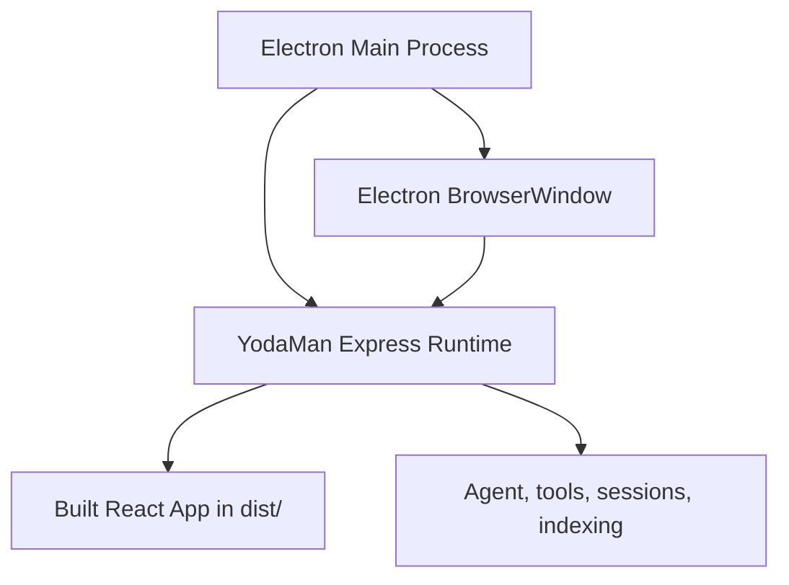

# YodaMan Desktop App

The desktop app packages the existing React interface with Electron and runs the existing Node backend as a managed local sidecar.

## Architecture



## Development Run

From the repository root:

```bash
npm run desktop
```

This command builds the React app and starts Electron (`electron/main.js`). Electron starts the backend if no runtime answers on port `3090` (`YODAMAN_PORT` changes it), shows a startup diagnostics page that polls `/api/health`, and moves to the app at `http://127.0.0.1:3090` once services are up.

## Package Directory Build

From the repository root:

```bash
npm run desktop:pack
```

This creates an unpacked desktop application in `release/` for the host platform.

## Full Distribution Build

From the repository root:

```bash
npm run desktop:dist
```

This builds for the host platform. `electron-builder.json` targets `dmg`, `zip`, and an unpacked directory on macOS, `nsis`, `zip`, and an unpacked directory on Windows, and `AppImage`, `zip`, and an unpacked directory on Linux. The script also runs the render smoke tests before packaging, the packaged-app smoke test after, and `npm run website:downloads`. `npm run desktop:dist:all` builds macOS arm64 and then Windows and Linux x64 in one run; see [Publishing](../operations/publishing.md) for why Windows installers must come from a native Windows build.

The current Electron Builder configuration uses `asar: false` intentionally. The managed Node sidecar starts `server.js` directly, and support can inspect packaged runtime files during local diagnostics. If public distribution requires tamper resistance, change this only after validating sidecar startup from an ASAR-packaged app.

## Runtime Behavior

- If a YodaMan runtime is already available on port `3090`, the desktop app reuses it. Electron then cannot restart it, and leaves it running on quit.
- If no runtime is available, Electron starts `server.js` as a sidecar process, with `YODAMAN_DATA_DIR` set to the app's user-data folder so `config.json` and `yodaman.db` live outside the bundle.
- The sidecar process is stopped when the Electron app quits.
- The desktop menu includes `Restart Managed Runtime` for sidecars started by Electron.
- The desktop menu and tray include `Copy Mobile Pairing Link` to create and copy a `yodaman://pair` link. The link carries this machine's LAN address, which a phone can reach once the runtime listens beyond loopback; see [Linking YodaMan Mobile](mobile-linking.md).
- The desktop menu includes `Add Project Folder`, which opens a native folder picker and registers the selected directory through the runtime.
- A tray icon offers Show YodaMan, Restart Managed Runtime, Copy Mobile Pairing Link, and Quit.
- The desktop app polls task state every 5 seconds and shows native notifications when a task needs approval or transitions to completed.
- Approval covers every action that changes something — file writes, patches, commands, and OpenSpec changes — not only whole-file writes. Reads and searches run without prompting. See [Approvals](../guides/approvals.md).
- The Agent Chat tab includes a **task presets** dropdown with a **📊 Impact Analysis** preset that prompts for affected files, breaking changes, and suggested tests before editing shared code.

Native notifications are local desktop notifications. They do not require mobile push credentials.

## Diagnostics and Pairing

The dashboard calls:

```http
GET /api/desktop/diagnostics
```

to show the runtime PID, uptime, task count, pending approvals, and where the user's data files live. The response also carries host details, dependency status, and plugin policy metadata.

The dashboard can also create a mobile pairing link with:

```http
POST /api/pairing
```

The Dashboard sends its own origin as the `runtimeUrl`, so in the desktop app that link also points at `127.0.0.1`. Use a link created with your LAN address, and start the runtime with `YODAMAN_HOST=0.0.0.0`, to connect a phone on the same local network (see [Linking YodaMan Mobile](mobile-linking.md)).
